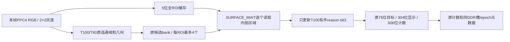

# 把 P02 的“有件/复核”优化移植到其他最新工程

> 本页说明R13到P02的前置成果；当前P03在其基础上新增亮边侧立条件，累计接入顺序及增量见[P03_PORTING.md](P03_PORTING.md)。本页源清单及验证数值固定对应P02标签。

本页回答：在哪里改了什么、增加了什么、解决了什么，以及怎样保留接收工程已有的功能。完整交接见 [P02_HANDOFF.md](P02_HANDOFF.md)。当前成果分支是 `lj4747-contest-work`，基于 R13 提交 `06f2b2e44a02e571edc33e7fb24018f5f1b50cb9`；发布标签为 `p02-present-surface-20261024`。功能提交的确切 SHA 记录在 [INTEGRATION.json](../releases/p02_20261024/INTEGRATION.json)。

## 1. 解决的问题与实际成果

原版本连停稳的正常正面也显示“待复核”。本轮 P01 现场读数中，正常和背面都是 `RS=C8`：T100 已确认有件，尺寸、长宽比、填充通过，外侧暗参考失败。因此简单清除原因位8会同时放行背面。

同一目标、同一源帧的内部灰度显示：正常四周最低值/中心约86.22%，背面约74.49–74.79%，背侧72%。P02把T100有件的第3位质量条件改为器件内部表面证明，保留原低3位几何/填充、弱T80、空穴/定位孔和计数逻辑。仿真中密排正常放行，背面、侧立、低填充和弱灰继续复核；用户收到P02后反馈“测试正常”。这是本轮总体反馈，未附逐速度/光照矩阵。

## 2. 改动文件：从 R13 到最终 P02

工程根为 `fpga/component_inspector/`。以下是累计P01测量与P02分类所需的全部RTL范围。

|文件|变化|作用|
|---|---|---|
|[present_surface_check.v](../fpga/component_inspector/user_source/hdl_source/present_surface_check.v)|新增|缓存整个双ROI及16px内窗上下文；同源帧逐候选测C/L/R/T/B，给出内部表面通过/复核|
|[present_review_probe.v](../fpga/component_inspector/user_source/hdl_source/present_review_probe.v)|新增|独立只读8位诊断；绑定当前首有效显示目标，显示原因/来源/内部均值/原左右暗格，缺窗清零|
|[frame_shape_search.v](../fpga/component_inspector/user_source/hdl_source/frame_shape_search.v)|修改|共享现有2×2原生灰度；保留弱T80来源和暗参考；加入`SURFACE_WAIT`，对全部8个真实候选逐一测量，只替换T100有件reason[3]|
|[isp/isp_top.v](../fpga/component_inspector/user_source/hdl_source/isp/isp_top.v)|修改|透传使能；把原128位CAL载荷改为两个诊断包；发布元数据同时等待分类、计数和只读探针就绪|
|[design_top_wrapper.v](../fpga/component_inspector/user_source/hdl_source/design_top_wrapper.v)|修改|生产顶层启用`ENABLE_PRESENT_SURFACE=1`和`ENABLE_REVIEW_PROBE=1`，透传ISP/显示参数|
|[classified_dual_page_osd.v](../fpga/component_inspector/user_source/hdl_source/classified_dual_page_osd.v)|修改|透传诊断显示参数|
|[compact_inspector_osd.v](../fpga/component_inspector/user_source/hdl_source/compact_inspector_osd.v)|修改|将诊断字段映射到PRB1/2；保持原字体、Logo、时序和计数页主体|
|[compact_template_rom.v](../fpga/component_inspector/user_source/hdl_source/compact_template_rom.v)|修改|诊断页标题DETECT/COUNT P02，原CAL两行替换为PRB两行；关闭诊断参数时仍为原R13界面|
|[camera_to_dsi_display.al](../fpga/component_inspector/td_project/camera_to_dsi_display.al)|修改|新增两个模块到编译清单；依赖由98变100，准备工具重定位运行描述符|

`classified_pocket_counter.v`、`classified_count_pipeline.v`、视频/DDR/帧保护、原测试和gold、引脚及完整SDC均保留原字节。源清单共504项；增量中另有测试、参考和准备/校验工具。生成的TD路径描述符也会随工程位置变化，不能当作算法改动。完整累计差分见 [R13_TO_P02.patch](../releases/p02_20261024/R13_TO_P02.patch)。

关键实现位置：[完整性及采样范围](../fpga/component_inspector/user_source/hdl_source/present_surface_check.v#L23)、[内部比值比较](../fpga/component_inspector/user_source/hdl_source/present_surface_check.v#L64)、[候选等待](../fpga/component_inspector/user_source/hdl_source/frame_shape_search.v#L693)、[仅替换reason[3]](../fpga/component_inspector/user_source/hdl_source/frame_shape_search.v#L711)、[元数据就绪等待](../fpga/component_inspector/user_source/hdl_source/isp/isp_top.v#L347)。

## 3. 判据、资源与接口

```text
灰度 = floor((R + 2G + B)/4)
每2×2像素再取均值，保存该均值的高5位。
C5：16×16处理像素中心区的均值。
L5/R5：左右各8×16；T5/B5：上下各16×8。
正常表面 = 当前帧缓存完整 && 32×32内窗可用
         && C5 >= ceil(FOREGROUND/8)
         && 5*min(L5,R5,T5,B5) >= 4*C5
```

默认FOREGROUND=100，所以中心门槛13。P02没有提高原填充下限，也没有直接清除所有复核位。`reason[0:2]`仍分别为尺寸、比例、填充；T100有件的`reason[3]`改为内部表面/完整性失败。弱T80特殊F仍原样保留。有效的其他种类沿用原路径。

默认1280×720时，新增分类缓存x[384,896)、y[224,616)，12544×20位；4个5位灰度格共用一个RAM字，新增13块ERAM。R13基础87块，加P01诊断3块，再加P02分类13块，最终103/108。P01诊断缓存仍只覆盖各ROI中央128×96；它的缺窗状态**不限制P02对完整ROI和全部8个计数候选的分类覆盖**。



76位对象、304位显示对象、608位计数候选和887位总元数据宽度都保留。每个候选在`PUBLISH`前完成表面检查，计数器消费的仍是共享分类器的真实结果。没有把前一帧框、节距推算或显示槽号当作本帧证据。

## 4. 移植时必须一起保留的部分

1. **像素时序。** 当前为1280×720处理域、96位RGB888/PPC4、100MHz处理时钟。`gray_word`与`cap_write/gray_x/gray_y`严格对齐；write_x对应一组8像素中后半PPC4的起点。内存保存前后两行、四个2×2灰度格。若接收版本改过PPC、缩放、行有效或灰度公式，先重做独立像素/字节相位检查。
2. **使能依赖。** 当前`SURFACE_ACTIVE = SURFACE_REVIEW && REVIEW_PROBE && REGIONS`；生产顶层启用两项，并要求现有CALIBRATION_MODE/ROI配置。只打开SURFACE_REVIEW、关闭REVIEW_PROBE，会回到原路径。若接收版本要隐藏诊断UI，需把采集使能和显示使能分开设计并重新验证，不能同时关掉分类所需的灰度采集。
3. **同帧完整性。** frame_start、pixel_sof、invalidate取消旧计算并清缓存计数；RAM内容无需复位，但没有当前完整采样证明必须保持复核。原生RAW坏帧/WB切换仍取消标签，视频保持原保护行为。
4. **所有候选。** 在REF_ORIGIN对每个有效、非弱T80的有件发请求，等待surface_ready，再完成原参考/发布。覆盖显示2/ROI和额外计数候选，不能只修屏幕上的第一个框。
5. **bank绑定。** weak_bank随候选复制/插入移动；诊断首槽选择须检查found，首槽无效才能退第二槽。有效首目标为空穴/未知时不跳到后面的有件，避免跨目标/跨帧拼数。
6. **元数据。** 原CAL的128位改为PRB载荷，ISP发布同时等search_probe_ready；保留源epoch与DDR槽绑定。更快的live计数不可覆盖旧显示帧的类别/编号。
7. **ROI与尺度。** 新分类缓存按当前默认ROI公式加16px上下文生成。若接收版本改变ROI位置、分辨率、3528比例或型号，重新推导缓存覆盖、RAM容量和内窗，不将此次80%判据当成所有成像条件的通用标定。

## 5. 原因码与诊断显示的兼容变化

每路64位诊断：63有件、62只读内窗有效、61弱T80来源、60:57最终reason、56:49左暗格、48:41右暗格、40保留、39:32/31:24/23:16/15:8/7:0为C/L/R/T/B八位均值。两路复用总元数据[629:502]，原CAL有效标记为[630]，计数部分仍为[886:631]。

P02的RS首位C/E代表诊断内窗可用，8/A不可用；E/A带弱T80标记。第二位8在P02表示内部表面/完整性失败；DARK仅保留原暗参考观察值，有件判定不再依赖它。旧程序若按CAL1/2固定空间均值解析这128位，需要同步改为PRB协议；8位诊断均值也不能直接当作“逐格截5位再求均值”的内部结果。

## 6. 在另一分支沿用

在接收分支先保存自己的工作，fetch本分支，然后读取发布清单中的功能提交SHA：

```powershell
git fetch origin lj4747-contest-work
$p02Info = git show origin/lj4747-contest-work:releases/p02_20261024/INTEGRATION.json | ConvertFrom-Json
git show --stat $p02Info.functional_commit
git cherry-pick $p02Info.functional_commit
```

若origin不是这个仓库，可另加remote指向`https://github.com/czp-1-A1/FPGA_Component_Inspector.git`再fetch。功能提交是建议的移植单元；后续文档/发布回执提交用于查证身份和下载。与R13相同的基线可直接采用已冻结P02；接收工程已有其他改动时，按上表和流程解决冲突，保留它自己的计数、DDR、按键及约束改动。手工移植后是一个新集成版本，应冻结新源和重新构建，不能沿用此bit的SHA或时序结论。

## 7. 复现和验收

先按 [P02_HANDOFF.md](P02_HANDOFF.md)执行`verify_p02.py`和`prepare_p02.py`，从新的英文短路径构建。原始源码与100项硬件依赖必须核对；保持原完整SDC/seed2。

新增独立单测在`sim/surface/`；原生RAW和界面入口`sim/run_surface_tests.ps1`。原RTL按Verilog编译，测试台才用-sv。P01的旧专用UI参考保留为历史，P02使用`sim/surface/verify_surface_ui_pixels.py`。

本版实际通过：26请求/105均值精确对照；8完整RGB帧、64记录/280个参考均值/36个预期质量位变化；关闭新参数2506968拍记录/探针/ready与P01一致；7合成RAW源帧、24个质量判据/60个8位诊断均值/12538000显示像素；启用新判据的70帧计数序列；24项相关原回归；P02与原默认UI各3686400像素零差异。原72项未全部重跑。

实际Routed Slice18266/21216(86.10%)、ERAM103/108、DSP28、PLL5，双角setup+0.005ns/hold+0.020ns、TNS0；46条max-delay/Ignored0、20Gray主导8ns/扇出、6邮箱/SW3及coverage通过。源工具TD6.2.168116、ModelSim SE64 2019.2；接收工程需重新完成物理验收。最后固定EXP1092/GAIN40/MODE0/WB100/100，复测正常、背面、短侧、长侧、背侧及ROI内移动；保留新版本的实物真值和视频记录。
