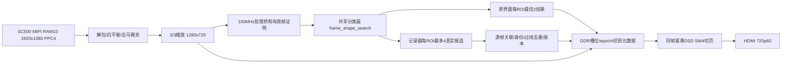

# R13完整工程交接：供其他AI接续

日期2026-10-23。当前分支`lj4747-contest-work`，R13冻结标签`r13-compact-resource-20261023`。用户授权上传R13并详细交接；本次仅集成冻结源、证据与文档，不改RTL、不重编bit、不操作板卡。

## 1. 哪一份是答案

- 正式bit：`releases/r13_20261023/PocketCount_SW3_CompactResource_r13_20261023.bit`，1789539字节，SHA `2350b5985afa679df3d8bfd1a5fa2aba9f355468f284704d10dd46beeda402a7`。
- 正式完整包：同目录`PocketCount_SW3_CompactResource_r13_20261023_full.zip`，6453085字节，SHA `96db469ed1c9359c21d1053822621cf0789ba86bd48017144442cf776a425cd9`。
- 冻结manifest：同目录`frozen_inputs.json`，471输入；文件本身SHA `243651b68a39160cfb81efe91b11836bcb32109750ecd29793530fca1bc98c65`。
- 当前工程`fpga/component_inspector`中这471输入与完整包逐字节相同；新增`README_R13.md`与`R13_FROZEN_INPUTS.json`是外部入口。已有的其他文件、旧handoff、旧镜像保留作历史，不用glob把整个目录中的旧RTL或旧Runs当作生产输入。用准备脚本仅复制manifest输入到新目录。
- 上传前远端HEAD为479a30b426d3a7edcde280d7bb202155fde4f310（20261019 small-dual说明），它是本次Git集成父提交，不等于R13算法基线。R13实际来自R12/458输入冻结`90a4772bdf1fb07c11455bbb042f76ee0aae8c01752bab5a5cf2574963ba4763`，不应把旧small-dual五文件补丁直接套回R13。
- 历史README与ZIP内handoff/current_status是当时快照，可能仍写PHY运行、未推送或待板测。最终外部交付回执、归档复原证据和本说明优先。历史运行PID不是当前进程，不可照抄重启。
- 2026-10-23用户总体反馈R13上板“没问题”；未提供新的逐速度逐排列统计。原交付记录`field_count_proven=false`保持原样，后续人工反馈单独记录，不倒改历史证据。

## 2. 用户需求与范围

单条载带只通过既有固定检测ROI；不再做全画面自动找载带。两路ROI是原分类界面的兼容能力，计数一次只选一个可信ROI。保留同型号3528物料、约180mm成像条件、近水平送料，支持左右任一单向运行，本工程不控制电机。

计数只消费共享分类器的真实有件/空穴结果，完成身份关联、去重、过线记录、分项累计与空穴号保存；不建立独立外槽检测器，不把定位孔或节距推算当真实穴位。待复核属于有件的质量提示。最多300穴。

两页保持上下栏、ROI主要位置、安路Logo与测试信息，类别中文“有件/空穴/待复核”。资源优化不得牺牲原分类、计数、四种视图、曝光/增益/WB、帧保护、DDR绑定和CDC约束。

## 3. 像素/时钟/元数据链



原采集1920×1080，输入PPC4，行480组；缩放后1280×720，每组仍4像素。计数处理域100MHz，显示74.25MHz/串行371.25MHz，实际PLL/派生时钟以SDC和报告为准。输入FPS常见约26，不可用HDMI60替代。

`frame_process_bridge`、`roi_frame_guard`、`scaled_frame_guard`隔离源帧并验证尺寸/完整性；视频优先发布，结果迟到通过现有DDR槽位与epoch附着。重复HDMI显示栅格不驱动计数。显示空间标签仅用该显示帧元数据，不能用更快更新的live总数给旧画面贴ID。

## 4. 分类器如何给记录器供数

关键源：`user_source/hdl_source/frame_shape_search.v`、`inspection_region_config.v`、`isp/isp_top.v`。

共享检测器对2×2真实像素求均值，建立T100主体与T80小孔掩码，共享连通域引擎，再用尺寸/形状、位置、局部暗参考、主体及定位孔排除规则分类。生产参数默认支持3528；换型号/成像尺寸需重新测量，不是自动模型识别。

默认1280×720 ROI：上路x400..880/y240..400；下路x400..880/y432..600。中央线x640。源码可能有旧160×104 small-dual说明，它不是R13的默认边界。区间边界的闭开语义以当前比较语句为准。

R12已加入同源帧双阈值几何佐证：特定T80 4×4高填充小轮廓，只有同帧同框唯一T100圆形证据且原尺寸/排/暗区/排除规则仍满足才允许空穴。未改T100/T80阈值，不凭周期生成空穴。60个受控真圆fixture只从42通过到45，不能称全部反光或全部相位已解决。R13与R12分类器逐字节相同。

显示`region_objects[303:0]`每ROI2记录；记录侧`recorder_objects[607:0]`每ROI最多4候选。显示槽位会换序，槽号不是持久身份。记录器只选一个ROI的4候选参与匹配。

每目标76位：

| 位 | 字段 |
|---|---|
|75|valid|
|74:73|kind：0无目标，1不确定，2有件，3空穴|
|72:69|原分类reason4位|
|68:56|foreground/面积13位|
|55:49 /48:42|宽/高7位|
|41:31 /30:20|x0/x1，各11位|
|19:10 /9:0|y0/y1，各10位|

低位记录在前。UI OBS只统计显示2/ROI，不代表记录器全部4/ROI。`hold_valid/x/y`是关联保留提示，不是计数器输出的新类别证据。原观察类别仍由共享分类器产生。

## 5. 计数状态、身份与失联恢复

关键源`classified_pocket_counter.v`、`classified_count_pipeline.v`。生产顶层显式启用RESULT_RECORDER、MOTION_RECOVERY、TAIL_RECOVERY、ORDERED_HANDOFF、RECOVERABLE、VELOCITY_ASSOC、LOCAL_RECOVERY和MULTITHRESHOLD_EMPTY；这些模块的默认关闭参数服务旧回归，不能只读默认值推断生产行为。

状态：0 READY，1 ACQUIRE/LOCKING，2 RUN，3 LOST，4 DONE，5 HOLD，6 CHECK。新段不补计启动时已在线下游的目标。记录模式用真实目标中心跨x640±4px滞回线，先在上游见到并保留身份，满足真实跨线后只发一次。保留最多32跟踪身份及待发队列、最多300账本项和空穴号；停车保留身份。

R9/R10允许短暂断续的真实返回和速度辅助关联，预测仅帮助寻找同一目标，不能生成事件。R11在局部缺失超出顺序等待后隔离单个身份，让后续真实可靠目标继续，已计目标不重复。未确认身份被绕过后冻结`uncertainty_from`，后续只保证记录顺序，不虚补物理穴号。晚返回必须仍是实际唯一观测，不能用线性外推补数。坏帧、配置失效、明确反向、容量/重叠等完整性保护仍可停计；不能承诺任何故障都永不LOST。

一次新事件为单处理时钟脉冲：`event_valid`及`event_run[15:0]`、`event_id[8:0]`、`event_frame[31:0]`、`event_kind[1:0]`、`event_reason[3:0]`。类别和源帧取实际排队时原证据，不能用发出时最新类别覆盖。现在ISP实例未接外部事件端口，若要对接串口/软件/NG队列可从这里引出，并另做CDC/容量/回压契约，不能直接跨域采脉冲。

`TOTAL=PRESENT+EMPTY`；REVIEW是PRESENT子集。kind1不能直接变为已计空穴。节距只供关联与异常判断；测不到或只在下游首次出现的目标不能凭空补号。达到300自动DONE。当前没有停机电机控制或完整NG复检执行器。

### 256位记录扩展

原有图像元数据后加256位计数记录。所有位号相对这256位；跨域/DDR总宽应读`META_WIDTH`表达式，不套早期常数。

| 位 | 当前字段 |
|---|---|
|31:0|源帧ID|
|47:32|内部运行段ID|
|50:48 /54:51|状态/跟踪原因C|
|55/56/57|方向有效/向右/选中ROI|
|66:58 /75:67 /84:76 /93:85|total/present/empty/review，均9位|
|129:94|四个显示槽ID，各9位；只对该源帧有效|
|201:130|当页8个空穴号，各9位|
|210:202 /212:211 /216:213|最近记录ID/类别/原分类reason|
|222:217 /223|空号页0基索引/有效标志|
|239:224|显示用RUN计数，与内部运行段tag用途不同|
|255:240|历史首错diagnostic16位|

LOCAL_RECOVERY把未使用ROI的低9位槽ID复用为`uncertainty_from`：选上ROI时bits120:112，选下ROI时bits102:94；活动ROI的18位显示ID不变。不能把这个字段解读成另一路目标ID。首错细分为`{subreason4,track6,gap4,direct_count2}`；C是跟踪原因，分类reason另存，二者不可混用。FIRST恢复RUN后仍保留到清零/新段，不表示当前仍失锁。

## 6. 拨码、显示和测试读数

- SW4上检测、下计数，仅切显示；计数仍基于同一源结果流。
- SW3上拨后下拨开始；上电保持下拨不自动开始，不因保持下拨反复开段。K1+K4不是当前生产启动方式。
- K3+K4长按1秒：RUN、总数/分项、空号、GAP、首错全清；不是旧版仅结束保留汇总。组合键抑制曝光/增益副作用。
- 保留原曝光/增益/WB控制和四视图：MODE0 RAW、1灰度、2边缘、3灰度加边缘。
- 两页保留中文类别、小框、Logo，上下栏保留EXP/GAIN/FPS/WB/CFG/V、源尺寸/帧、OF/UF/LOST、L/F/I/G与发布诊断。计数页有C/RUN/LAST/FIRST、空号轮播、GAP提示。
- GRAY为原采样统计，OBJ是当前ROI首个有效显示目标，不一定同一个取样对象；CAL1/2仍是原探针，其M/MIN/MAX/W/H/A显示HEX，数量/曝光/FPS等常用值为十进制。
- GAP以前N号才可视为确认穴位号；`GAP FROM Rnnn / IDS UNCONFIRMED`以后R是记录顺序，不能把空号表当作完全可靠的实物编号。先保存证据，再清零复测。

## 7. R13改了什么、资源为什么仍高

R13只做A行缓存容量和B两页共享显示，未采用C检测缓存裁剪。与R12相比原分类、计数/恢复、ROI、帧桥、CDC、SDC、原测试台保持；顶层与ISP仅传递已有参数、显示选择和所需源列表。

行缓存：1920/PPC4每行480组，三类客户端地址宽缩到9位/深512；AWB96位、RAW33/32位数据宽、读写模式、调度/输出控制不变。厂商包装器默认仍11位/2048兼容旧引用。相关六个容量RTL在`signal_delay.v`、demosaic的`line_buffer_demosaic.v/zhenghe.v`及三类RAM包装器。

显示：新增`compact_inspector_osd/compact_ascii_rom/compact_cjk_rom/compact_template_rom`，共享ASCII、七个中文字符、原Logo、模板和顺序数字转换。`classified_dual_page_osd`默认COMPACT_UI=0保留旧回归分支，生产显式1。帧首快照、行8前文本就绪，RGB/DE/HS/VS保持三时钟延迟。

| 项 | R12 | R13最终Routed |
|---|---:|---:|
|Slice|19947/21216=94.02%|19708/21216=92.89%|
|ERAM|105/108|87/108=80.56%|
|DSP|27/40|28/40|
|PLL|5/6|5/6|
|setup/hold|见旧冻结|+0.002/+0.020ns|
|setup/hold TNS|见旧冻结|均0|

释放18ERAM、239Slice，低于90%的Slice目标未达成；不隐瞒增加的1DSP。最终面积细分见`releases/r13_20261023/resource_breakdown_20261023.md`。那里LUT占比不是每模块Slice占比，不能当作可释放量。

## 8. 软件、物理和归档证据

原72项必测：25项因实际输入变化重编重跑；47项严格逐SHA复用原真实compile/runtime和像素结果，不冒充全重跑。详细列表`evidence/required_tests.json`，逐项证明`evidence/software_verification.json`，完整原日志在ZIP的`validation/tests`。

另有三种尺寸1920/1280/1024实际厂商行RAM双DUT等价、WB验证；共享UI四完整1280×720图共3686400像素独立参考零差异；动态RGB930274时钟/921600有效像素/163200未覆盖像素与三拍控制验证。10套native RAW与86源帧RGB独立参考、44源帧字段和真实像素编号绑定通过。

TD6.2.178840最终同SDC/seed2 Routed：setup+0.002、hold+0.020、TNS0，46条max-delay匹配/Ignored0，20Gray位原8ns及6邮箱/SW3完整扇出审计通过。`evidence/routed_verification.json`只是索引，全部路径报告在ZIP的`build_evidence/classified_audit`，旧DDR/PLL/I/O警告边界仍保留，不称零警告。

完整包1225项SHA/CRC、471冻结输入、72日志、原94加4显示模块共98项目/IP依赖在新目录独立复原通过。没有为了过关降低约束、改原oracle或盲换seed。

明确保留的失败：必测72之外旧pixel_interface诊断在原R12与R13均同185行/38460ns失败；早期UI保留字、RGB记分器复位、补全未读HEX库存、归档旧94计数等失败均随ZIP保存。补全47旧证据不改原运行日志/输入，追加HEX是未被旧测试读取的库存资料。历史封包脚本含本机绝对路径和旧94断言，只作过程证据；接手用本仓库`scripts/r13`入口，不直接运行旧one-shot脚本。

## 9. 换电脑复原、仿真与构建

环境：Windows，TD6.2.178840（本机D:/td6.2.1）、ModelSim SE64 10.5（D:/modeltech64_10.5/win64）、Python3.12；像素参考需要NumPy/Pillow。有效厂商许可证/TD安装与仿真库由接手电脑提供，仓库不包含许可证、密钥或软件安装包。工具与厂商模型SHA见`evidence/toolchain_manifest.json`。

```powershell
git clone --branch lj4747-contest-work https://github.com/czp-1-A1/FPGA_Component_Inspector.git D:/FpgaWork/R13_git
Set-Location D:/FpgaWork/R13_git
git status --short --branch --untracked-files=all
git log -1 --oneline
python scripts/r13/verify_r13.py
python scripts/r13/prepare_r13.py --work D:/FpgaWork/R13_build --td D:/td6.2.1
```

`verify_r13.py`不依赖厂商工具；核对Git工程471源、正式bit/ZIP/说明SHA、完整1225载荷CRC/SHA与98项目依赖清单。准备脚本只在新ASCII无空格目录复制manifest文件、归一化.al位置元数据并生成运行描述；不动冻结RTL/SDC，将新描述seed固定2。原准备函数默认seed1，直接跑它不等于复现已验收seed2。

仿真在新目录运行，显式给ModelSim路径和含`common/`、`ph1p/`的TD仿真库根目录（安装路径因电脑而异）：

```powershell
& D:/FpgaWork/R13_build/sim/run_modelsim.ps1 -ModelSimBin D:/modeltech64_10.5/win64 -TdSimRoot D:/VendorModels/sim_release -OnlyTests @('compact_ui','line_ram_equivalence')
```

上例在同一PowerShell会话传数组；不要把两个测试名拼成一个字符串传给另一个powershell.exe进程。完整72列表见JSON，不传OnlyTests会包含历史额外诊断，并不保证每个旧诊断通过。原工具默认路径是历史值，不能无参直接照搬。

构建顺序：新目录`syn_1`工作目录执行`td_commands_prompt.exe build.tcl`；软件全门通过后再到`phy_1`执行同命令。物理完成后在新工程根执行`td_commands_prompt.exe tools/classified_audit_routed.tcl`，再`python tools/verify_classified_physical.py <新工程根>`。输出/路由时序必须重新审计，不能用SYN估计或进程退出0代替验收。准备通过不是重新综合通过；新电脑重编也不保证bit逐字节一致，烧录验收应绑定新SHA。

原完整包也可先解压，使用其中`scripts/prepare_portable_project.py --source ... --manifest ... --work ... --td ...`；若要复现seed2，需按本入口同样设置新描述。旧脚本硬编码历史D盘路径的回归/封包驱动需外部适配，禁止改冻结测试期望来适应环境。

## 10. 继续优化/合并时的边界

当前没有新的R14 bit。另一次资源小试r0/r1/r2/r3/r4的SYN差值仅-6/-18/-4/+100/-19 Slice，全部未采用，生产仍完整R13；这些未路由试验不属于本次上传的可烧录答案。

保留R13冻结，在另一个实现副本研究计数候选记录/索引、串行化发布与运算共享。面积目标不能靠删源帧绑定、坏帧保护、CDC同步或空号记录达成。先查数据生产/消费/保持时间、完整位宽与原帧ID对应，分别比较LUT/FF/ERAM/DSP和最终时序。

若合并其他分类算法，统一76位对象、源帧ID/有效帧证明与ROI坐标；分类器只产真实观测，记录器只关联/记账。不把屏幕标签/槽序当身份，不另跑一套不相关计数检测器。追加NG队列/复检时用事件接口和稳定run+ID+source_frame键。

现场请人提供同一冻结bit、EXP/GAIN、源FPS、载带总数/P/E及空号真值；分别记录漏计、重计、类别错、GAP与失锁。高速空穴目前仍缺统一量化速度/位移边界，不能只靠手机视频证明分类器内部帧帧有结果。必要时新增只读、同源帧绑定的原始观测诊断，与用户合作取数；不要盲目继续扩大阈值。

接棒前确认前实现端停止；先核对分支/HEAD/暂存/未提交/未跟踪文件。一次只一个实现端写入。冻结后独立测试；失败和复测分存，不边测边改答案。用户操作唯一板卡，AI未经授权不操作JTAG/Flash。构建和归档放D盘，新bit/完整包/说明/SHA放桌面独立版本名。每个可续小步骤更新AGENTS，按用户授权提交推送；成功推送且远端核验后才称已同步。
